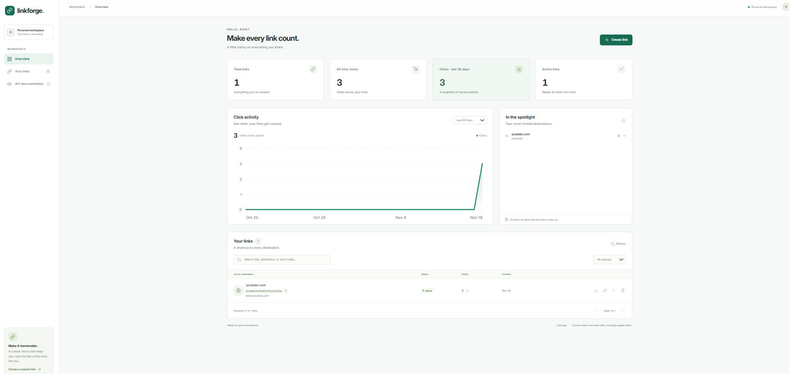
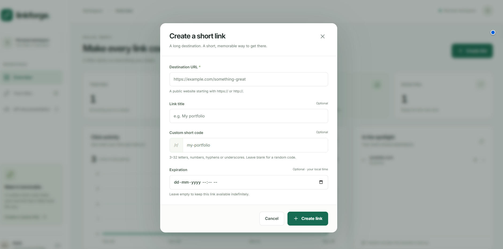
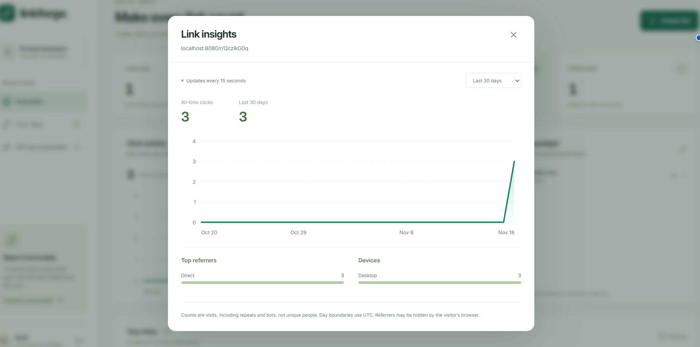
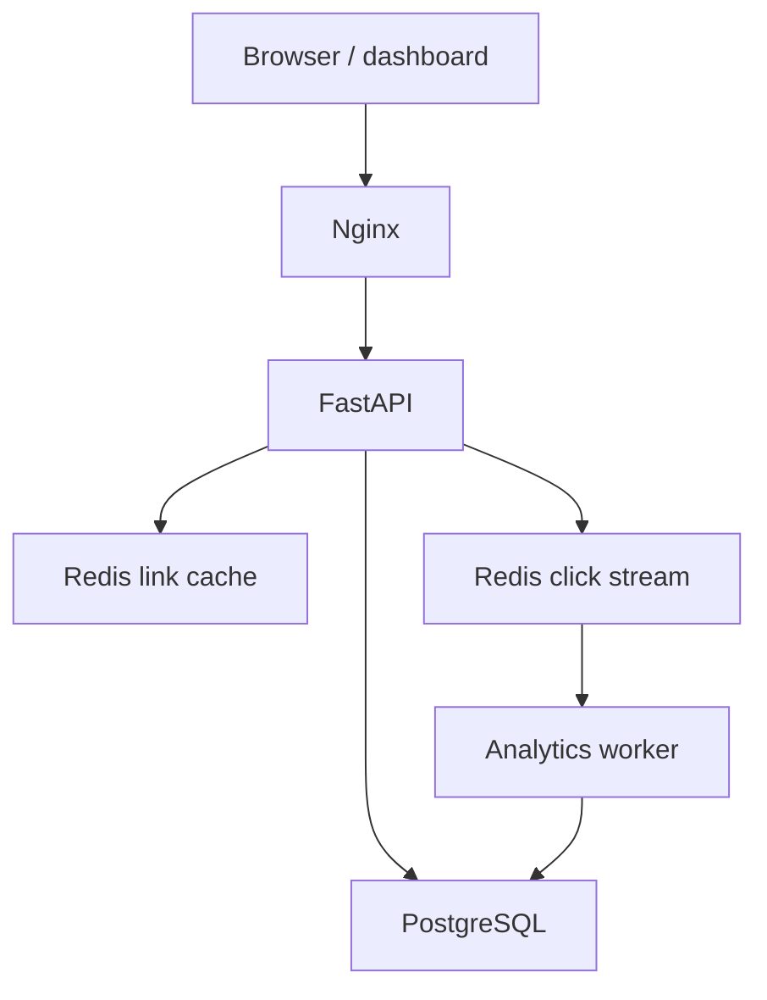

# Linkforge

**A complete URL shortener with a real backend, a React dashboard, and an asynchronous analytics pipeline.**

Create short links, choose custom aliases, set expiration dates, pause or delete links, and inspect click activity. The project is organized to make the database, cache, authentication, failure handling, and deployment decisions understandable in a system design interview.


## Application Screenshots

### Dashboard


### Create a Short URL


### Click Analytics

  

## What is included

| Area | Implementation |
| --- | --- |
| API | FastAPI, Pydantic request validation, OpenAPI / Swagger |
| Storage | PostgreSQL, async SQLAlchemy, Alembic migrations |
| Short codes | Random eight-character Base62 codes; database uniqueness and collision retry |
| Accounts | Argon2 password hashing, short-lived JWT access tokens, per-owner authorization |
| Links | Custom aliases, editable destinations/titles, expiration, pause/resume, soft deletion |
| Dashboard | React + TypeScript, responsive layouts, real API-backed charts and link management |
| Cache | Redis cache-aside, expiration checks, mutation invalidation |
| Rate limiting | Atomic Redis counters for authentication and link creation |
| Analytics | Redis Streams, consumer group worker, pending-event recovery, idempotent DB writes |
| Operations | Docker Compose, health endpoints, metrics, GitHub Actions, smoke/load scripts |
| Learning | Architecture notes, trade-offs, capacity math, interview walkthrough |

This repository is the runnable implementation. Public hosting is a separate step: no domain, server, or cloud account is bundled. See [deployment](docs/DEPLOYMENT.md) when you are ready to put it online.

## Start here: Docker

Install **Python 3.11+** and **Docker with Docker Compose v2**. Windows users should install and open Docker Desktop with its Linux-container / WSL 2 backend. Node.js is unnecessary for the Docker route: the frontend is compiled inside its image.

Extract the source ZIP. Open a terminal inside the `linkforge` folder, where `docker-compose.yml` is located:

```bash
python scripts/setup.py
docker compose up --build
```

On Windows, `py -3 scripts/setup.py` also works. Alternatively, run `start_windows.bat` from the extracted folder. On macOS/Linux, use `sh start.sh`.

Setup creates `.env` with fresh database, Redis, and JWT secrets. It preserves an existing `.env`. Keep this file private and out of Git. The initial build downloads images and dependencies; subsequent starts reuse them.

Once services are healthy:

| Open | Address |
| --- | --- |
| Dashboard | <http://localhost:8080> |
| Interactive API docs | <http://localhost:8000/docs> |
| Readiness | <http://localhost:8080/health/ready> |

Create your own account in the dashboard, then add a link such as `https://example.com/`. Copy the generated `/r/...` URL and open it. Return to the dashboard and refresh analytics; the worker processes clicks asynchronously.

**There is no default account or seeded password.** The charts reflect actual requests to your links, including your own test visits.

```bash
# Keep services running in the background:
docker compose up --build -d

# Inspect status / logs:
docker compose ps
docker compose logs --tail=100 api worker

# Stop containers; preserve the named data volumes:
docker compose down
```

`docker compose down -v` deletes the database and Redis data volumes. Use it only for an intentional full reset.

For a command-by-command walkthrough, [WINDOWS_SETUP.md](docs/WINDOWS_SETUP.md) explains setup, common errors, ports, and your first successful workflow.

## Architecture



Nginx serves the built React app and forwards `/api`, `/r`, `/health`, and API documentation requests. FastAPI uses PostgreSQL as the source of truth. Redis accelerates redirects, coordinates rate limits, and accepts click events. The worker commits analytics to PostgreSQL and then acknowledges the event.

Redis cache and stream are logical roles on one Redis instance in this small deployment. At larger scale, separate them so cache traffic and queue persistence can be tuned independently.

Read [ARCHITECTURE.md](docs/ARCHITECTURE.md) for data flows, cache consistency, queue semantics, and failure behavior.

## Repository map

| Path | Responsibility |
| --- | --- |
| `backend/app/` | API, configuration, models, authentication, caching, analytics, worker |
| `backend/alembic/` | Versioned database migrations |
| `backend/tests/` | Automated API, security, caching, concurrency, and worker checks |
| `frontend/src/` | React dashboard, API client, types, components, and styling |
| `docker-compose.yml` | PostgreSQL, Redis, migrations, API, worker, frontend |
| `scripts/setup.py` | Generates local configuration and fresh secrets |
| `scripts/smoke_test.py` | Tests a running deployment through HTTP |
| `scripts/benchmark.py` | Measures redirects without following destinations |
| `.github/workflows/ci.yml` | Backend tests, real services, migrations, frontend build |
| `docs/` | API reference, deployment, Windows guide, system design notes |
| `deploy/` | Optional Caddy HTTPS overlay and trusted-proxy configuration |

## Development without Docker

This mode uses SQLite and writes analytics inline, so you can start the actual application without PostgreSQL or Redis. It deliberately does **not** exercise the distributed rate limiter, Redis cache, or stream worker. Use Docker for the full architecture.

### Backend — Windows PowerShell

Open a terminal in `linkforge`:

```powershell
py -3 -m venv .venv
.\.venv\Scripts\python.exe -m pip install -r backend\requirements-dev.txt
cd backend
$env:ENVIRONMENT = "development"
$env:DATABASE_URL = "sqlite+aiosqlite:///./linkforge.db"
$env:REDIS_URL = ""
$env:ANALYTICS_MODE = "inline"
$env:RATE_LIMIT_ENABLED = "false"
$env:PUBLIC_BASE_URL = "http://localhost:5173"
$env:CORS_ORIGINS = '["http://localhost:5173"]'
..\.venv\Scripts\alembic.exe upgrade head
..\.venv\Scripts\python.exe -m uvicorn app.main:app --reload
```

### Backend — macOS/Linux

```bash
python3 -m venv .venv
.venv/bin/python -m pip install -r backend/requirements-dev.txt
cd backend
export ENVIRONMENT=development
export DATABASE_URL=sqlite+aiosqlite:///./linkforge.db
export REDIS_URL=''
export ANALYTICS_MODE=inline
export RATE_LIMIT_ENABLED=false
export PUBLIC_BASE_URL=http://localhost:5173
export CORS_ORIGINS='["http://localhost:5173"]'
../.venv/bin/alembic upgrade head
../.venv/bin/python -m uvicorn app.main:app --reload
```

### Frontend — another terminal

Install Node.js 22.12+ first. From `linkforge`:

```bash
cd frontend
npm ci
npm run dev
```

Open <http://localhost:5173>. Vite proxies API and redirect requests to the backend on port 8000. The frontend and backend must both remain running.

## API essentials

Authentication uses `Authorization: Bearer <access_token>`. Register returns a user; log in to obtain the token. The frontend stores its token in `sessionStorage`, clears it at logout or on a `401`, and signs the user out when it expires. Logout does not revoke a copied token; it expires after its configured short lifetime. A refresh/revocation system is a future extension.

| Method | Endpoint | Access |
| --- | --- | --- |
| POST | `/api/v1/auth/register` | Public, rate limited |
| POST | `/api/v1/auth/login` | Public, rate limited |
| GET | `/api/v1/auth/me` | Authenticated |
| POST | `/api/v1/urls` | Authenticated, rate limited |
| GET | `/api/v1/urls` | Current user's links |
| GET / PATCH / DELETE | `/api/v1/urls/{id}` | Link owner |
| GET | `/api/v1/urls/{id}/analytics?days=30` | Link owner |
| GET | `/api/v1/dashboard?days=30` | Current user's analytics |
| GET / HEAD | `/r/{short_code}` | Public |
| GET | `/health/live`, `/health/ready` | Public |

Complete bodies, response fields, filtering, expiry, error codes, and curl examples are in [API.md](docs/API.md). Swagger also generates executable examples from the actual server.

## Test and measure

```bash
cd backend
python -m pip install -r requirements-dev.txt
pytest tests -q

cd ../frontend
npm ci
npm test
npm run typecheck
npm run build
```

The default backend test suite uses temporary SQLite and a Redis-compatible fake for fast, isolated checks. Set `TEST_DATABASE_URL` and `TEST_REDIS_URL` to run the same fixtures against actual PostgreSQL and Redis. Only use a disposable database with `test` in its name and Redis database 15: the tests reset their storage. CI contains both test modes.

The frontend component suite renders the production React components against controlled HTTP fixtures. It exercises account errors, expired sessions, link forms, filtering, pause/resume, deletion confirmation, analytics, and keyboard focus. Fixture data is confined to tests; the shipped application uses the real API. See [VERIFICATION.md](docs/VERIFICATION.md) for the checks completed on this delivered source and the checks that still require a Docker host.

With the full application running, install `httpx` in your Python environment and run:

```bash
python scripts/smoke_test.py --base-url http://localhost:8080
```

The smoke script creates two temporary accounts, checks cross-owner access is denied, creates and redirects a link, waits for worker analytics, updates the link, and soft-deletes it. It does not follow the external destination. The disposable accounts remain in the local database.

Measure an existing **test link** on infrastructure you own:

```bash
python scripts/benchmark.py http://localhost:8080/r/YOUR_CODE --requests 1000 --concurrency 20
```

The report includes p50/p95/p99 latency, throughput, errors, and status counts. These requests count as clicks. Record your machine, concurrency, application configuration, dataset size, cache condition, and error rate beside any result. No throughput or percentage improvement is assumed in this repository.

## Engineering decisions and practical limits

- PostgreSQL guarantees short-code uniqueness. The large random namespace alone cannot guarantee it.
- Redirects use `302` and `Cache-Control: no-store`, so browsers are asked to return to the service for subsequent visits and observe destination changes.
- Expired or paused links return `410`. Deleted and unknown links return `404`; deleting a link does not release its alias for reuse.
- Analytics count observed GET requests, not verified humans or unique visitors. Bots, previews, reloads, and deliberate requests can all affect totals.
- Queue delivery is at least once. Unique event identifiers prevent a replayed event from creating a second database row.
- Redis AOF with `appendfsync everysec` improves durability but can lose recently accepted events during a hard failure. This is not a zero-loss analytics system.
- When Redis is unavailable, redirects fall back to PostgreSQL and analytics try an inline database write. Auth/creation limits in production fail closed. If recording a click fails, redirect availability takes priority and the loss is logged.
- Link mutations invalidate the cache. An unavailable Redis can leave an old entry until its short TTL expires; immediate global revocation during outages is not guaranteed.
- The application stores referrer hostnames and a derived device category, not raw IP addresses or full user agents. There is no geolocation or unique-person attribution.
- URL validation blocks unsafe schemes and obvious local/private literal targets. The server never fetches destinations. A public service still needs an abuse-reporting/moderation process and stronger malicious-domain screening.

These limits are useful interview material. [SYSTEM_DESIGN.md](docs/SYSTEM_DESIGN.md) explains how to evolve the implementation as requirements change.

## Deployment and maintenance

For an internet-accessible deployment, configure `PUBLIC_BASE_URL`, `TRUSTED_HOSTS`, and allowed origins for your hostname; put HTTPS in front of the frontend; keep PostgreSQL/Redis and `/metrics` private; configure backups and log retention. The API's direct port is deliberately bound to `127.0.0.1` in Compose.

See [DEPLOYMENT.md](docs/DEPLOYMENT.md) for a server deployment, the included optional Caddy HTTPS configuration, migration/backup practices, recovery checks, and service-health interpretation.

## References

The implementation uses the documented behavior of [FastAPI security](https://fastapi.tiangolo.com/tutorial/security/oauth2-jwt/), [SQLAlchemy async sessions](https://docs.sqlalchemy.org/en/20/orm/extensions/asyncio.html), [Redis Streams](https://redis.io/docs/latest/develop/data-types/streams/), [Redis pending-event recovery](https://redis.io/docs/latest/commands/xautoclaim/), [Alembic](https://alembic.sqlalchemy.org/en/latest/), and [Docker Compose startup order](https://docs.docker.com/compose/how-tos/startup-order/).

License: [MIT](LICENSE).
