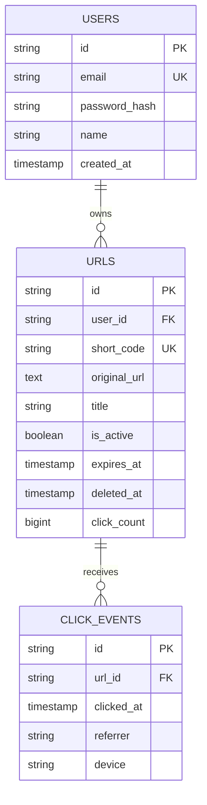
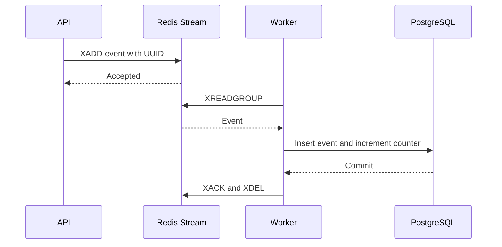

# Architecture and implementation notes

## 1. Scope

Linkforge is one API application and one analytics worker, backed by PostgreSQL and Redis, with a React client. The API is stateless with respect to user sessions and link storage. The worker uses the same application package and database models. Separating these processes lets redirect traffic and analytics processing scale independently without creating a microservice for every feature.

The dashboard is a real client of the API. SQLite/inline mode is a convenience for development; Docker starts the full PostgreSQL/Redis architecture.

## 2. Persistent records

UUID values are stored as 36-character strings for consistent PostgreSQL/SQLite behavior. A production-only schema could use native PostgreSQL UUID columns. URL timestamps are normalized to UTC; SQLite's missing timezone metadata is repaired by a SQLAlchemy type decorator.

The short-code unique constraint is the authority for collisions. Indexes on `(user_id, created_at)` and `(url_id, clicked_at)` support listing links and time-bounded analytics. `click_count` is a denormalized counter updated in the same database transaction as inserting a new event. Replayed event IDs cannot increment it again.

Deletion is soft. The row and its code remain to prevent a previously shared alias from being reassigned to a different owner. The UI and redirect endpoints exclude deleted rows. An administrative retention/hard-delete process is a separate concern.

## 3. Creating a link

1. Validate the JWT and load the user.
2. Apply the Redis creation limit keyed by user.
3. Validate the destination and optional alias/expiry.
4. Choose the requested custom alias or generate eight random Base62 characters using `secrets`.
5. Insert the link. If a generated code collides with the unique constraint, generate another and retry. If a requested alias collides, return `409`.
6. Return its configured public URL.

There is no “check then trust” uniqueness guarantee: only the database insert arbitrates concurrent claims. An alias precheck alone would allow two processes to both observe a free name.

The destination is stored but never fetched by the backend. This avoids turning shortening into a server-side URL fetch feature. Public HTTPS URLs are still not proof of safe content; phishing protection requires a separate policy and detection system.

## 4. Redirecting a link

The redirect handler checks Redis first. Cached data includes the link ID, destination, active flag, and expiration. It always evaluates expiration against current server time, so an expiry does not have to wait for a Redis TTL.

On a cache miss, the handler queries PostgreSQL and caches the returned link state with a short TTL. Missing or deleted links are rejected, and active/expiry checks are applied to both cached and database-derived state before redirecting. The short URL is case sensitive.

For GET, a click event is submitted to Redis Streams. The redirect waits for that enqueue operation but does not wait for the analytics database transaction or any reporting query. If Redis cannot accept the event, an inline database fallback is attempted. This preserves many counts at the cost of extra latency during an outage. The runtime has finite database connection, pool, and command timeouts; the fallback can still add several seconds. If both recording paths fail after a mapping was resolved, the redirect still succeeds and the drop is logged and counted in metrics.

For HEAD, the API returns the same redirect metadata without recording a click. Browser previews commonly use GET as well, so HEAD exclusion does not make the analytics a human-only count.

`302` plus `Cache-Control: no-store` asks clients to re-check the service for future requests. The design does not rely on a permanently cached `301`, which would complicate edits and server-side click counting. Clients can still behave differently; request counts are not guaranteed visit counts.

## 5. Cache mutation races

A naive cache-aside implementation can restore stale data after a mutation:

1. Request A misses the cache and reads the old database record.
2. Request B changes the database and deletes the cache entry.
3. A fills Redis with the old value, undoing the invalidation.

This implementation uses a generation number per code. A cache read captures the current generation. Invalidation atomically increments that generation and deletes the data. A Lua cache-fill operation writes the mapping only if the captured generation still matches. This blocks the stale-fill sequence above when Redis is reachable.

The generation keys intentionally outlive data keys, preventing a generation from resetting while an old read is in flight. They consume memory over time. At very large scale, use controlled generation-key compaction, a different version scheme, or a cache design with stronger ownership semantics.

The database commit and Redis invalidation are not one atomic transaction. A read may observe the previous cache entry during that brief interval. A failed invalidation can leave a stale mapping until its TTL expires. Default TTL is 60 seconds. Strict instantaneous revocation during a Redis outage would require a stronger design, such as avoiding cached authorization state or checking an authoritative revocation service.

## 6. Analytics delivery and recovery

The worker's consumer group distributes new events among workers. An event remains pending if a worker dies before acknowledgment. `XAUTOCLAIM` recovers pending events whose idle time exceeds the configured threshold. The default is 60 seconds, so recovery is intentionally not instantaneous.

The worker commits before acknowledging. If it crashes after the commit but before acknowledgment, the event is delivered again; its unique ID causes the second insert to do nothing, leaving the count unchanged. This is **at-least-once transport with an idempotent database effect**, not a claim of exactly-once delivery.

Acknowledged entries are removed for this single consumer-group design. Adding an independent second consumer group would require changing deletion/retention: one group's acknowledgment must not erase events another group still needs.

The primary stream is not trimmed with `MAXLEN`, because trimming can silently discard events not yet processed. A stopped worker therefore creates a growing backlog. Compose gives Redis a configurable `REDIS_MAXMEMORY` (default `256mb`) and uses `noeviction`, so writes requiring more managed memory are rejected instead of evicting queued messages. Memory outside that limit, including AOF/replication buffers and persistence overhead, still needs host headroom. Monitor memory and queue lag; consider a separate queue instance and archival retention as traffic grows.

Malformed event payloads go to a bounded dead-letter stream. Database failures leave events pending for retry. Investigate repeated failures instead of allowing a poison event to accumulate indefinitely.

Redis AOF is enabled with fsync once per second. An accepted XADD can still be lost during a hard failure before it reaches durable storage. A stronger durability requirement needs replicated/quorum acknowledgment or a transactional database outbox, with the resulting latency/availability trade-off. See the official [Redis persistence guide](https://redis.io/docs/latest/operate/oss_and_stack/management/persistence/) and [Streams documentation](https://redis.io/docs/latest/develop/data-types/streams/).

## 7. Authentication and authorization

Passwords are Argon2 hashed. The API validates JWT signatures using an explicitly configured algorithm, issuer, audience, expiration, and subject, then resolves the user. Every management/analytics query is restricted to that user's ID. A valid JWT does not grant access to another owner's link.

The UI holds the bearer token in `sessionStorage` to survive reloads within a tab. JavaScript can read this storage, so preventing XSS remains essential; React text escaping and restrictive browser headers help. There is no refresh-token rotation or server-side token denylist. Logout removes the browser token; a copied token remains valid until expiry. These are explicit v1 boundaries.

Cookie authentication would introduce different CSRF and browser-session trade-offs. It is not mixed into this bearer-token implementation.

## 8. Rate limiting

A Redis Lua script atomically increments a counter and establishes its expiry. Authentication requests share an IP-based limit; link creation uses the account ID. Current defaults are 20 authentication attempts per 60-second window and 100 link creations per 3,600-second window. Exceeding the limit returns `429` with `Retry-After`.

This counter window begins with the first request; it is not a rolling per-second token bucket. Burst behavior near expiry is a known trade-off. The local development fallback is process-local and must not be presented as a distributed limiter.

Production authentication and creation fail closed if Redis cannot provide a rate-limit decision. Redirects continue using PostgreSQL. IP-based enforcement behind a proxy depends on a trusted forwarded-address configuration; exposing a proxy-trusting API directly to the internet would let clients spoof that identity.

## 9. Failure matrix

| Failure | Redirect behavior | Management / analytics behavior |
| --- | --- | --- |
| Redis cache/stream unavailable | Read PostgreSQL; attempt inline click write | Production auth/create can return `503`; analytics reads can still use DB |
| Worker stopped | Redirect/enqueue still work until resource limits | New clicks lag; backlog grows |
| Worker crashes before commit | Redirect unaffected | Pending event recovered later |
| Worker crashes after commit | Redirect unaffected | Replay is deduplicated |
| PostgreSQL unavailable | Valid cache hits may still redirect | DB-backed operations fail; queued events wait |
| Redis and PostgreSQL unavailable | Only previously obtained in-flight data can help; ordinary lookups fail | No general availability guarantee |
| Invalidated cache cannot be reached | Old cached destination may be served after Redis recovery | Bounded by cache TTL |
| Redis instance loses unflushed AOF data | Some accepted clicks/cache state can be lost | No zero-loss count guarantee |

Readiness returns `503` when PostgreSQL connectivity is unavailable and a degraded `200` when only Redis is unavailable. It checks connectivity, not schema correctness, Redis write capacity, or worker progress. A load balancer should interpret this alongside the endpoint it is serving: some degraded redirects are still useful even when creation is blocked.

## 10. Observability and growth

The API records request counts/latency by route template, cache lookup outcomes, analytics ingestion outcomes, and Redis operation failures. Avoid labels containing short codes, emails, or full destinations: unbounded label cardinality is expensive and can expose data. Request logs use generated request IDs.

Metrics are per process. If scaling to multiple API processes, scrape each instance separately and aggregate in monitoring; do not assume one process's metrics represent the whole deployment. Worker logs and Redis pending/backlog information remain essential because API liveness does not prove the consumer is keeping up.

The default deployment has single PostgreSQL and Redis instances, so it has no database/queue high availability guarantee. Add replication, failover, backups, restore drills, and operational ownership when availability requirements justify them. Design for measured bottlenecks; see [SYSTEM_DESIGN.md](SYSTEM_DESIGN.md).
